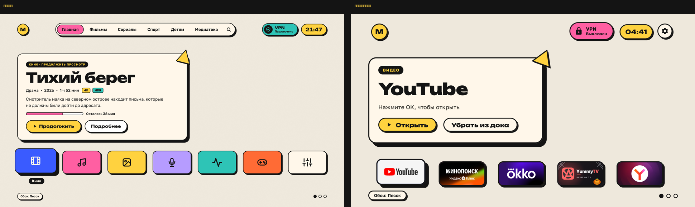
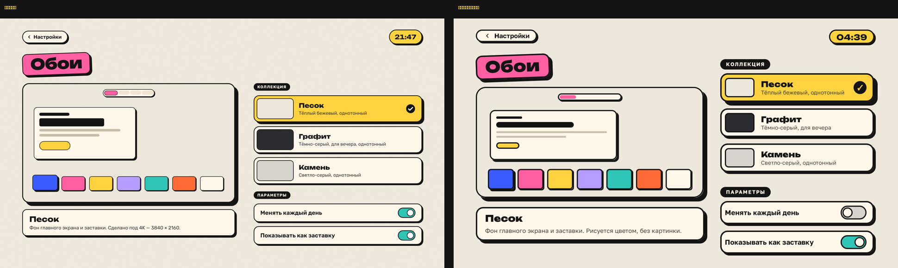
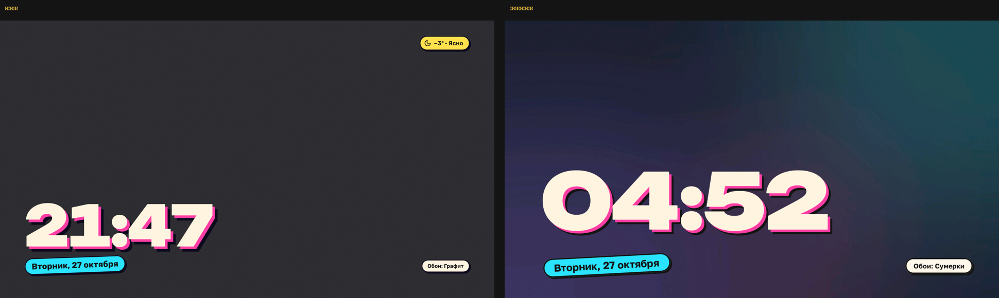
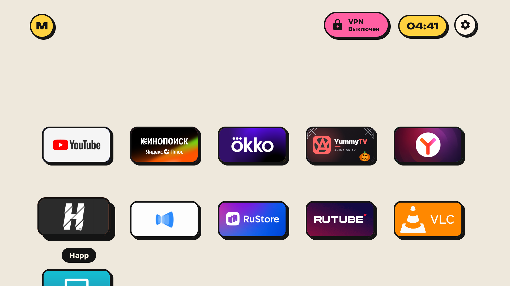
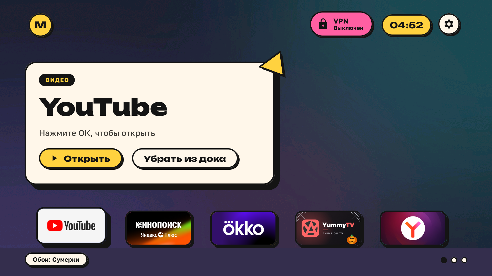

# Чистка телевизора Сбер (Салют ТВ) + новый лаунчер

Убирает мусор Сбера с телевизора на StarOS (Салют ТВ) и ставит свой главный экран в стиле необрутализм:
песочный фон, кремовые карточки с толстой обводкой и жёсткой тенью, цветные плитки, огромные часы на заставке
и **любые ваши обои**.

Проверено на **Sber SDX-50U4139** (50", 4K, 2 ГБ, Android 13, плата CVTE `TP.T962D4.PC756` / `at30a6`). Подходит
и для других Сбер‑ТВ на этой плате — 43" `at30a6` ([список](examples/sber-salute-tv-at30a6/README.md)); для
32" `pb766` есть [свой список](examples/sber-salute-tv-pb766/README.md).

| Главный экран: макет → телевизор |
|---|
|  |

| Обои | Заставка |
|---|---|
|  |  |

| Все приложения | Обои‑картинка «Сумерки» |
|---|---|
|  |  |

## Что получится

- **Без мусора Сбера.** Отключены Звук, SberPrime, «Видео», детская комната, умный дом, опросы, бета, сберовский
  «YouTube», Салют‑браузер, заставка Сбера, обновления прошивки и ещё около 15 пакетов. **Ничего не удаляется** —
  всё возвращается одной командой. Голосовой помощник, HDMI, пульт и AirPlay работают.
- **+234 МБ свободной памяти**, и StarOS перестаёт сам удалять ваши приложения при нехватке места.
- **Новый главный экран:** док из любимых приложений с их баннерами, большая карточка приложения в фокусе
  («Открыть» / «Убрать из дока»), пилюля VPN (Happ), часы, остальные приложения ниже.
- **Любые обои** — однотонные или картинки, свои или готовые (см. ниже). Смена раз в день по желанию.
- **Заставка:** огромные часы с розовой тенью и дата по‑русски поверх ваших обоев.
- **Кнопки пульта:** «ТВ» открывает Happ, «RUTUBE» — YouTube. Назначаются на любые приложения одной строкой.
- Шрифты Unbounded и Golos Text с кириллицей. Лаунчер не ходит в интернет, без рекламы и аналитики.

## Обои — ставьте любые

На ТВ: шестерёнка вверху справа → **«Обои»**. Там вся коллекция, превью главного экрана и два переключателя:
«Менять каждый день» и «Показывать как заставку».

**Своя картинка** — любой JPG или PNG: фото, арт, градиент, что угодно.

1. Положите файл в [`examples/sber-sdx-50u4139/wallpapers/`](examples/sber-sdx-50u4139/wallpapers).
2. Допишите его название в `wallpapers/captions.txt` — имя файла, Tab, название:
   ```
   07-moya-kartinka.jpg	Моя картинка
   ```
   (без строки в списке будет видно просто имя файла).
3. Отправьте на ТВ: `TV_HOST=<tv ip> tools/theme.sh examples/sber-sdx-50u4139`
4. Выберите её в «Обоях».

Размер — **1920×1080** хватит: интерфейс ТВ рисуется в 1080p даже на 4K‑панели, картинка больше будет
выглядеть так же, но занимать больше памяти.

**Однотонные обои** — вообще без картинки, рисуются цветом и не тратят память. Добавляются строкой в
[`config.json`](examples/sber-sdx-50u4139/config.json), ключ `neo_wallpapers`, формат `"Название|#цвет|Описание"`:

```json
"neo_wallpapers": [
  "Песок|#EEE8DC|Тёплый бежевый, однотонный",
  "Графит|#2C2B30|Тёмно-серый, для вечера",
  "Мята|#CFE8DC|Светло-зелёный"
]
```

Готовые: Песок, Графит, Камень и 6 картинок — Рассвет, Сумерки, Холмы, Баухаус, Туман, Терраццо. Часы на
заставке сами становятся тёмными на светлых обоях и светлыми на тёмных.

## Как поставить

Нужен Mac или ПК в той же Wi‑Fi сети, что и ТВ.

**Проще всего — через ИИ‑агента** (Claude Code и подобные): дайте ему [`PROMPT.md`](PROMPT.md) и
[инструкцию для этого ТВ](examples/sber-sdx-50u4139/README.md). Он сам подключится, покажет, что будет отключено,
и спросит перед каждым шагом.

**Вручную:**

1. На ТВ включите **Настройки → Для разработчиков → Беспроводная отладка**, нажмите
   «Подключить устройство с помощью кода» и на компьютере выполните
   `adb pair <tv ip>:<порт> <код>`, затем `adb connect <tv ip>:<порт с экрана отладки>` и `adb tcpip 5555`
   (`adb` — `brew install --cask android-platform-tools`). `<tv ip>` — адрес ТВ в домашней сети
   (адрес `26.26.26.x` — это VPN, он не подходит).
2. Из папки этого репозитория:

```bash
python3 -m venv tools/venv && tools/venv/bin/pip install -r tools/requirements.txt
TV_HOST=<tv ip> tools/disable.sh examples/sber-sdx-50u4139/debloat.txt
cd launcher && TV_HOST=<tv ip> STOCK_LAUNCHER=ru.sberdevices.starlauncher INPUT_KEY_SERVICE=1 ./build-and-install.sh && cd ..
TV_HOST=<tv ip> tools/theme.sh examples/sber-sdx-50u4139
TV_HOST=<tv ip> tools/venv/bin/python tools/tv.py 'settings put secure screensaver_components com.gathin.tvhome/.ClockDream'
```

Для сборки лаунчера нужны JDK 17 и Android SDK 34: `brew install openjdk@17` и
`brew install --cask android-commandlinetools`.

3. В конце выключите на ТВ «Беспроводную отладку» и «Отладку по USB» и перезагрузите его.

Список под себя (что оставить, что отключить), док, кнопки пульта, откат и что делать, если Сбер вернул мусор —
в **[подробной инструкции](examples/sber-sdx-50u4139/README.md)**.

**Откатить всё:**

```bash
TV_HOST=<tv ip> tools/restore.sh examples/sber-sdx-50u4139/debloat.txt ru.sberdevices.starlauncher
```

## Что в репозитории

| Папка | Что там |
|---|---|
| [`examples/sber-sdx-50u4139/`](examples/sber-sdx-50u4139) | список отключения, настройки лаунчера (`config.json`), обои, инструкция |
| [`launcher/`](launcher) | исходники лаунчера (Java, Android 8+); новый стиль включается ключом `neo_style` |
| [`tools/`](tools) | скрипты: подключение (`tv.py`), отключение, откат, проверка, отправка темы, замеры |
| [`docs/`](docs) | что делать, если ТВ не подключается |
| [`PROMPT.md`](PROMPT.md) | правила для ИИ‑агента (англ.) |

Основано на [CleanYourTV](https://github.com/Gathin23/cleanyourtv) (лицензия MIT). Шрифты Unbounded и
Golos Text — SIL Open Font License ([launcher/FONT-LICENSE-OFL.txt](launcher/FONT-LICENSE-OFL.txt)).
